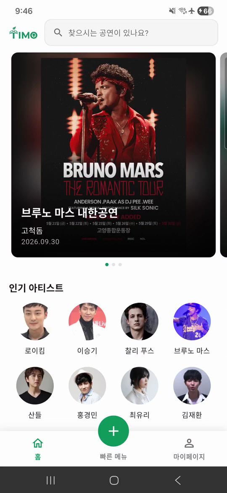
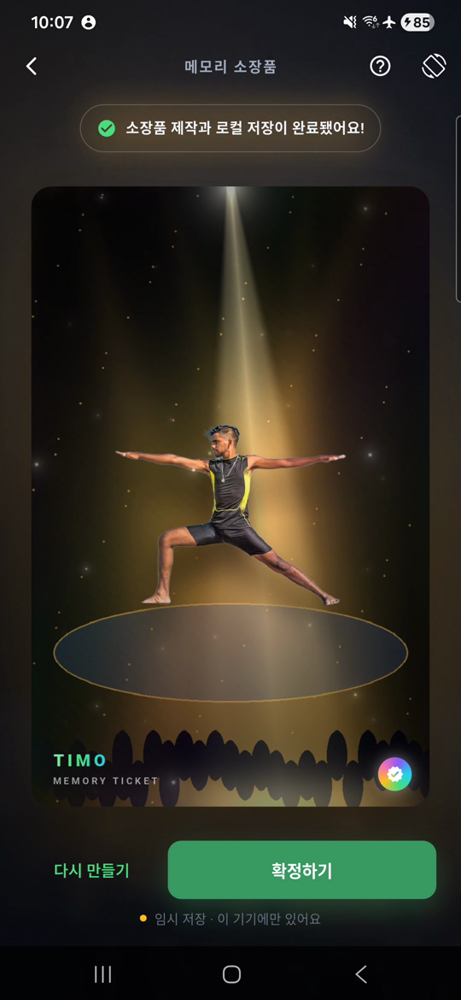
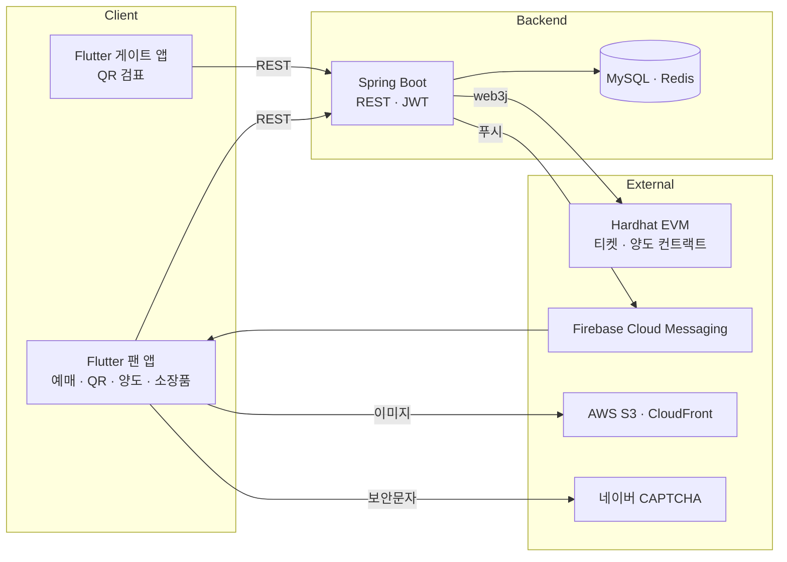
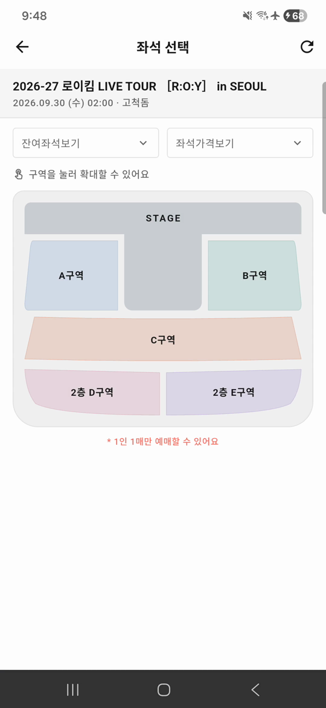
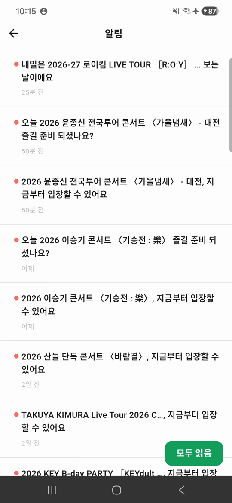
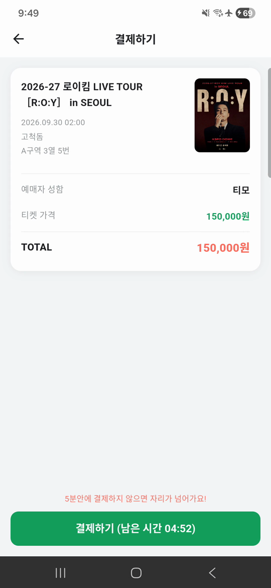

# TIMO — 블록체인 기반 공연 티켓 예매·양도 앱

> SSAFY 15기 특화 프로젝트 · 6인 팀 · 2026.08.17 – 2026.09.28
>
> 이 저장소는 팀 프로젝트에서 **제가 맡은 파트를 정리한 포트폴리오**입니다. 원본 코드는 SSAFY GitLab(비공개)에 있습니다.

<!-- TODO(민석): 서비스 한 줄 소개. 싸스케 README 의 "친구들과 화상으로 만나…" 줄에 해당. -->
공연 티켓을 예매하고, 입장 QR 로 검표하고, 못 가게 된 티켓은 양도 마켓에 올리고, 다녀온 공연은 소장품으로 남기는 **모바일 티켓 앱**입니다.

[데모 영상 보기 (mp4, 2분 38초)](docs/demo.mp4)

  
  
  
  

 

## 서비스 핵심 기능

<!-- TODO(민석): 팀원 파트 설명은 틀린 말이 들어가지 않게 한 번 더 확인. -->

| 기능 | 설명 |
| --- | --- |
| 예매 | 보안문자(네이버 CAPTCHA) → 구역·좌석 선택 → 앱 내 포인트(버섯) 결제 → 온체인 티켓 발행 |
| 입장 QR | 공연 시작 2시간 전부터 30초마다 갱신되는 입장 QR, 게이트 스캐너 앱으로 검표 |
| 양도 마켓 | 보유 티켓을 정가 이하로 등록·취소, 매물 구매 시 온체인 소유권 이전 |
| 알림 | 예매 오픈·양도 매물·입장 가능 등 FCM 푸시 + 앱 알림함 |
| 소장품 | 입장 완료한 공연의 티켓을 사진 누끼·이펙트로 꾸며 3D 카드로 보관 |

 

## 제가 맡은 파트 (Frontend · Flutter)

<!-- TODO(민석): 아래 소제목은 제안이다. 순서·개수는 바꿔도 되고, 각 항목은 싸스케처럼
     "문제 → 어떻게 풀었나 → 결과" 3~5줄이면 충분하다. 메모는 쓸 거리를 적어 둔 것. -->

### 1. 예매 흐름 — 보안문자 · 구역/좌석 선택 · 결제

<!-- 쓸 것: 네이버 CAPTCHA 를 네이티브 흐름에 끼운 방식(구역 화면 위 창, 진입 때 한 번만),
     좌석 칸 44px 고정 + 서버가 주는 열별 좌석 수로 사다리꼴이 만들어지는 구조,
     결제 후 "발행 대기 → 완료" 폴링. -->

### 2. 입장 QR — 만료와 새로고침 설계

<!-- 쓸 것: 30초 만료 QR 을 자동 갱신하지 않고 회색 처리 + 새로고침으로 둔 이유(사용자 결정),
     서버 문구 그대로 쓰기, 남은 5초 경고색, 입장 시간창(시작 2시간 전~)을 앱·서버가 같은 값으로. -->

### 3. 입장 완료 전환 — 조용한 푸시 + 폴링 보완

<!-- 쓸 것: 게이트에서 스캔하면 서버가 데이터 푸시(TICKET_ENTERED)를 보내고 QR 화면이 바로
     "이미 입장한 QR" 로 바뀜. 푸시가 빠지거나 늦을 때를 대비해 2초마다 입장 여부 재확인. -->

### 4. 내 티켓 · 양도 마켓 · 알림함

<!-- 쓸 것: 내 티켓 상태(발행 중 / 양도 등록 중 / 입장 완료 …)별 카드 문구와 더보기 잠금 규칙,
     양도 등록 가격 슬라이더, 알림 탭 → 공연 상세 이동, 푸시 수신 시 종 아이콘 점 갱신. -->

### 5. 테스트와 코드 정리

<!-- 쓸 것: 타이머가 있는 화면의 위젯 테스트(pumpAndSettle 대신 pump 로 시간 흘리기),
     326 파일 주석·구조 정리 때 세운 기준(주석 1~3줄, 왜를 적는다), dart format 범위 제한.
     테스트 파일 103개. -->

 

## 담당 파트 기술 스택

`Flutter` `Dart 3` `dio` `flutter_secure_storage` `hive` `firebase_messaging` `flutter_local_notifications`
`qr_flutter` `image_picker` `sensors_plus` `video_player`

 

## 아키텍처

전체 시스템은 Flutter 앱 2종(팬 앱, 게이트 검표 앱), Spring Boot 백엔드(MySQL·Redis·S3), Hardhat 기반 EVM 체인(티켓 발행·양도 컨트랙트)으로 구성된 6인 팀 프로젝트입니다.

 

## 화면

| 예매 | 입장 | 양도 · 알림 | 소장품 |
| --- | --- | --- | --- |
|  |  |  |  |
|  |  |  | |
|  |  | | |
|  | | | |
