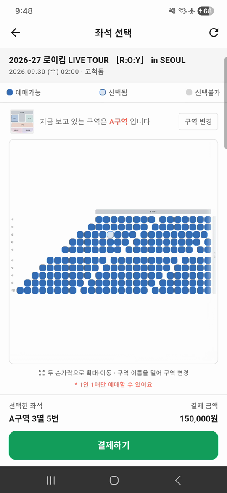
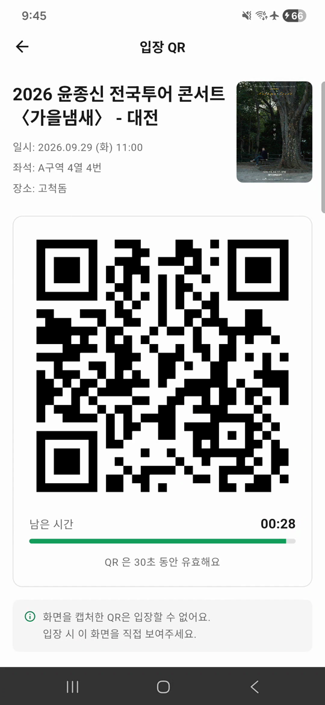
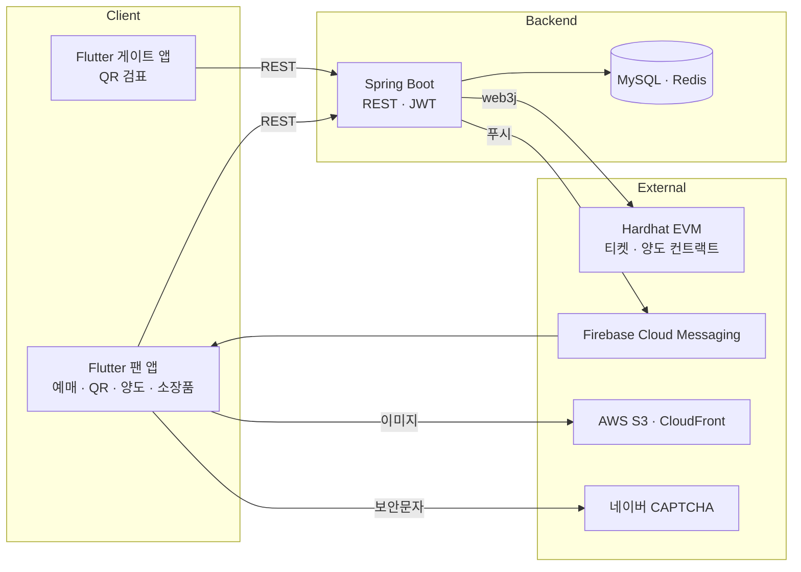
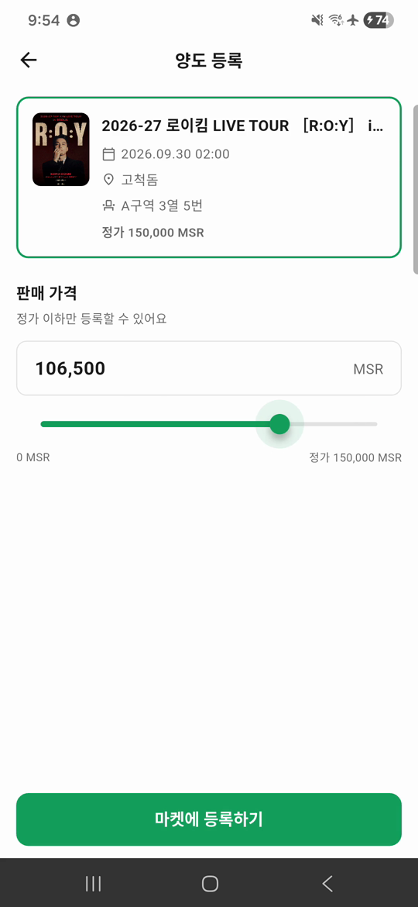
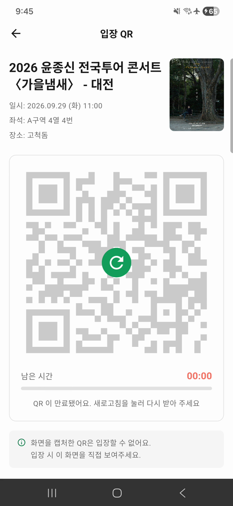
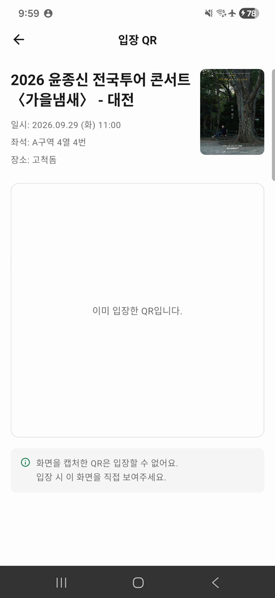
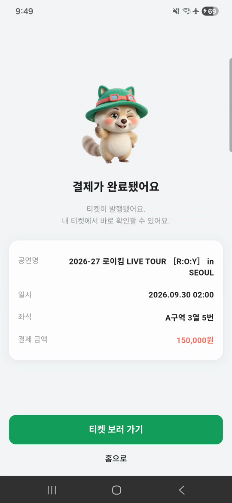

# TIMO — 블록체인 기반 공연 티켓 예매·양도 앱

> SSAFY 15기 특화 프로젝트 · 6인 팀 · 2026.08.17 – 2026.09.28
>
> 이 저장소는 팀 프로젝트에서 **제가 맡은 파트를 정리한 포트폴리오**입니다. 원본 코드는 SSAFY GitLab(비공개)에 있습니다.

공연 티켓을 예매하고, 입장 QR로 검표하고, 못 가게 된 티켓은 양도 마켓에 올리고, 다녀온 공연은 소장품으로 남기는 **모바일 티켓 앱**입니다.

[데모 영상 보기 (mp4, 2분 38초)](docs/demo.mp4)

  
  
  
  

 

## 서비스 핵심 기능

| 기능 | 설명 |
| --- | --- |
| 예매 | 보안문자(네이버 CAPTCHA) → 구역·좌석 선택 → 앱 내 포인트(버섯) 결제 → 온체인 티켓 발행 |
| 입장 QR | 공연 시작 2시간 전부터 받는 30초짜리 입장 QR, 게이트 스캐너 앱으로 검표 |
| 양도 마켓 | 보유 티켓을 정가 이하로 등록·취소, 매물 구매 시 온체인 소유권 이전 |
| 알림 | 예매 오픈·양도 매물·입장 가능 등 FCM 푸시 + 앱 알림함 |
| 소장품 | 입장 완료한 공연의 티켓을 사진 누끼·이펙트로 꾸며 3D 카드로 보관 |

 

## 제가 맡은 파트 (Frontend · Flutter)

### 1. 예매 흐름 — 보안문자 · 구역/좌석 선택 · 결제

예매 앞에 매크로를 막을 보안문자가 필요했습니다. Google reCAPTCHA 모바일은 점수형만 있고 hCaptcha는 그림 고르기라서, 글자를 읽고 입력하는 네이버 클라우드 CAPTCHA를 골랐습니다. 이미지를 받을 때도 Client Secret이 필요해서 네이버 호출은 백엔드가 맡고, 앱은 구역 화면 위에 창을 띄워 예매를 시작할 때 한 번만 묻습니다. 구역을 바꾸거나 결제하고 돌아올 때는 다시 묻지 않습니다.

좌석표는 공연장처럼 앞이 좁고 뒤가 넓어야 했는데, 칸을 줄여서 사다리꼴을 만들면 손가락으로 누르기 어려워집니다. 그래서 좌석 칸은 어디서나 44px로 두고, 열마다 자리 수를 서버 데이터로 다르게 받아서 모양이 데이터에서 나오게 했습니다. 결제가 끝나면 온체인 발행이 끝날 때까지 발행 대기 화면에서 상태를 확인합니다.

### 2. 입장 QR — 만료와 새로고침 설계

입장 QR은 30초가 지나면 만료됩니다. 처음엔 만료될 때마다 새 QR을 자동으로 받아 오게 만들었는데, 은행이나 출입 QR 앱에서 흔히 쓰는 방식대로 만료된 QR은 흐리게 하고 가운데에 새로고침 버튼을 두는 쪽으로 바꿨습니다. 남은 시간이 5초 아래로 내려가면 경고색으로 바뀝니다.

발급이 안 될 때는 서버가 준 문구를 그대로 보여 줘서 앱과 서버 설명이 어긋나지 않게 했습니다. QR이 열리는 시각(공연 시작 2시간 전)도 서버와 같은 값을 상수로 두고, 티켓 카드의 안내 문구도 이 상수에서 가져옵니다.

### 3. 입장 완료 전환 — 조용한 푸시 + 폴링 보완

게이트에서 QR을 찍어도 관객 폰의 QR 화면은 그대로라서, 입장이 됐는지 바로 알 수 없었습니다. 백엔드와 맞춰서 검표가 통과되면 서버가 알림 없이 데이터만 담은 푸시(`TICKET_ENTERED`)를 보내고, QR 화면은 자기 티켓이면 "이미 입장한 QR입니다." 안내로 바뀌게 했습니다.

푸시는 늦거나 빠질 수 있어서, 화면이 열려 있는 동안 2초마다 내 티켓 상태가 `USED`인지 한 번 더 확인합니다. 둘 중 먼저 오는 쪽으로 화면이 바뀝니다. 두 경로는 위젯 테스트 9개로 따로 확인했습니다.

### 4. 내 티켓 · 양도 마켓 · 알림함

처음 내 티켓 화면은 예매 목록을 그대로 썼는데, 예매 목록에는 티켓 상태가 없어서 양도 등록 중이거나 발행 중인 티켓도 QR 버튼이 열리고 서버에서 거절당했습니다. 소유 기준으로 주는 내 티켓 조회 API로 바꾸면서 티켓 상태를 발행 중·보유·양도 등록 중·입장 완료·환불 등으로 나누고, 상태마다 카드 문구와 더보기 메뉴를 잠그는 규칙을 정했습니다. 예를 들어 양도로 받은 티켓은 예매 취소만 잠그고, 잠근 이유를 함께 보여 줍니다.

알림함은 시안 없이 만들었습니다. 읽었는지는 "읽음" 같은 글자 대신 글자 굵기와 점으로 구분하고, 점이 사라져도 자리는 남겨서 글줄이 밀리지 않게 했습니다. 초록 바탕에 흰 글자는 이 크기에서 대비가 3.43:1로 기준에 못 미쳐서, 흰 바탕에 초록 아이콘으로 바꿨습니다.

### 5. 테스트와 코드 정리

결제 화면처럼 매초 카운트다운이 도는 화면은 `pumpAndSettle`이 끝나지 않아서 테스트가 멈췄습니다. Material 3 기본 화면 전환이 800ms라는 것도 이때 알았고, `pump`를 나눠서 시간을 직접 흘려 보내는 방식으로 타이머가 있는 화면의 테스트를 썼습니다.

프로젝트 막바지에는 소장품 기능을 뺀 프론트엔드 326개 파일을 정리했습니다. 안 쓰는 상수와 래퍼 위젯을 지우고 금액 포매터를 하나로 합쳤고, 주석은 "1~3줄, 왜 그렇게 했는지만"이라는 기준으로 다시 썼습니다. 정리 전후로 정적 분석 경고 0개, 전체 테스트 860개 통과를 확인했습니다.

 

## 담당 파트 기술 스택

`Flutter` `Dart 3` `dio` `flutter_secure_storage` `hive` `firebase_messaging` `flutter_local_notifications`
`qr_flutter` `image_picker` `sensors_plus` `video_player`

 

## 아키텍처

전체 시스템은 Flutter 앱 2종(팬 앱, 게이트 검표 앱), Spring Boot 백엔드(MySQL·Redis·S3), Hardhat 기반 EVM 체인(티켓 발행·양도 컨트랙트)으로 구성된 6인 팀 프로젝트입니다.

 

## 화면

| 예매 | 입장 | 양도 · 알림 | 소장품 |
| --- | --- | --- | --- |
|  |  |  |  |
|  |  |  | |
|  |  | | |
|  | | | |
